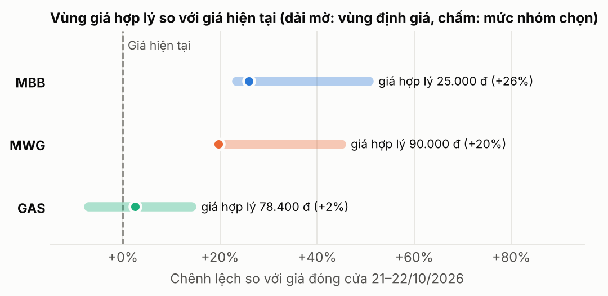

# Bài tập tình huống 1: Bối cảnh đầu tư và lựa chọn cổ phiếu

_Học phần Đầu tư tài chính. Vai trò: công ty quản lý quỹ. Vốn giả định 10 tỷ đồng, kỳ đầu tư 1 tháng (26/10 – 25/11/2026). Số liệu cập nhật đến 23/10/2026; nguồn ghi ở cuối báo cáo._

**Nguyên tắc phân tích:** đi theo phương pháp **top-down** (từ trên xuống, Chương 4): vĩ mô → ngành → doanh nghiệp. Mỗi kết luận vĩ mô phải chỉ ra được ngành nào hưởng lợi, và mỗi cổ phiếu được chọn phải gắn với một kết luận vĩ mô cụ thể.

## Tóm tắt cho nhà đầu tư

1. **Kinh tế tăng trưởng mạnh nhất từ 2022 nhưng lạm phát đã vượt mục tiêu.** GDP quý III/2026 tăng 9,95%, nhưng CPI tháng 9 tăng 5,08% (mục tiêu 4,5%) do giá dầu Brent quanh 100–114 USD/thùng. Ngân hàng Nhà nước vì vậy khó hạ lãi suất thêm.
2. **Thị trường đang ở vùng định giá thấp, có dòng vốn mới nhưng biến động mạnh.** VN-Index ở 1.760,6 điểm (22/10), thấp hơn đỉnh 1.903 điểm tháng 1. P/E thị trường khoảng 13,1 lần, thấp hơn bình quân 5 năm (14,4 lần). FTSE Russell nâng hạng Việt Nam lên thị trường mới nổi từ 21/9/2026.
3. **Chiến lược của nhóm: CÂN BẰNG**, gồm ba vai trò bổ sung cho nhau: một cổ phiếu **giá trị** (MBB, ngân hàng), một cổ phiếu **tăng trưởng** (MWG, bán lẻ) và một cổ phiếu **phòng thủ, thu nhập cổ tức** (GAS, khí đốt).
4. **Định giá:** MBB có giá hợp lý khoảng 25.000 đ (+26%), MWG khoảng 90.000 đ (+20%), GAS khoảng 78.400 đ (+2%). GAS không được chọn để tăng giá mạnh mà để **giảm rủi ro chung của danh mục** và phòng hộ trước rủi ro giá dầu.
5. **Loại HPG và FPT** dù lợi nhuận vẫn tăng, vì giá đang giảm kéo dài (HPG −12% từ đầu năm, FPT mất gần một nửa). Hai mã này dễ trở thành **tài sản bị thống trị** trong mô hình Markowitz ở Bài tập 2.

```
Vĩ mô 2026                         Ngành hưởng lợi              Cổ phiếu (vai trò)
GDP +9,95%, tín dụng tăng mạnh  ─► Ngân hàng                 ─► MBB  (giá trị)
Bán lẻ 9 tháng +13,4%           ─► Bán lẻ tiêu dùng          ─► MWG  (tăng trưởng)
Giá dầu cao, cầu điện khí tăng  ─► Khí đốt, năng lượng       ─► GAS  (phòng thủ, cổ tức)
Lạm phát 5,08%, lãi suất cao    ─► Rủi ro chung: ưu tiên mã có định giá thấp, tài chính vững
```

## 1. Phân tích bối cảnh đầu tư

### 1.1 Các yếu tố kinh tế vĩ mô

| Yếu tố | Số liệu mới nhất | Tác động đến thị trường chứng khoán |
|---|---|---|
| Tăng trưởng kinh tế | GDP quý III +9,95% (cao nhất từ 2022), 9 tháng +9,01%. Công nghiệp – xây dựng +12,5%, dịch vụ +9,5% | Tích cực: doanh thu, lợi nhuận doanh nghiệp tăng, nhu cầu vay vốn tăng |
| Tiêu dùng | Tổng mức bán lẻ 9 tháng +13,4% (loại trừ giá: +7,8%); quý III +14,5% | Tích cực cho bán lẻ, tiêu dùng |
| Lạm phát | CPI tháng 9 +5,08%; bình quân 9 tháng 4,52%; lạm phát cơ bản 4,26% | Tiêu cực: vượt mục tiêu 4,5%, làm giảm sức mua và hạn chế nới lỏng tiền tệ |
| Lãi suất | Lãi suất tái cấp vốn 4,5% (giữ nguyên). Lãi suất huy động 6–12 tháng tăng khoảng 1,2 điểm % đến tháng 3. Lãi suất liên ngân hàng từng lên 16,39% (2/2026). Gần đây khoảng 20 ngân hàng giảm lãi suất huy động khoảng 0,5 điểm % | Hai chiều: lãi suất cao làm tăng tỷ suất lợi tức yêu cầu k, xu hướng hạ nhiệt gần đây là tín hiệu tốt |
| Tín dụng | 6 tháng +7,73%; định hướng cả năm khoảng 15%, VCBS dự báo 16–18% | Tích cực cho ngân hàng, nhưng tín dụng tăng nhanh hơn huy động gây áp lực lên chi phí vốn |
| Tỷ giá | USD/VND trung tâm 25.627 (23/10), giảm nhẹ trong tháng | Ổn định, hỗ trợ dòng vốn ngoại |
| Giá dầu | Brent bình quân tháng 9: 114 USD/thùng; đầu tháng 10 khoảng 100 USD. EIA dự báo quý IV: 105 USD, năm 2027: 84 USD | Tích cực cho doanh nghiệp dầu khí, tiêu cực cho lạm phát và chi phí sản xuất |
| Trái phiếu Chính phủ | Lợi suất kỳ hạn 10 năm 4,36% (phiên đấu thầu cuối tháng 7/2026) | Được dùng làm lãi suất phi rủi ro Rf trong mô hình CAPM |

**Nhận xét.** Bức tranh vĩ mô có **hai mặt đối lập**. Mặt tích cực là tăng trưởng thực rất mạnh, dựa trên công nghiệp, đầu tư và tiêu dùng nội địa. Mặt tiêu cực là lạm phát, phần lớn đến từ giá năng lượng do xung đột ở Trung Đông. Liên hệ với mô hình chiết khấu cổ tức (Chương 4), giá trị cổ phiếu V₀ = D₁/(k − g) chịu hai lực ngược chiều: g (tăng trưởng) đang tăng nhờ kinh tế, còn k (tỷ suất lợi tức yêu cầu) khó giảm vì lãi suất bị lạm phát giữ ở mức cao. Vì vậy, **cổ phiếu có lợi thế là cổ phiếu có lợi nhuận tăng trưởng thật và định giá còn thấp**, chứ không phải cổ phiếu chỉ tăng giá nhờ kỳ vọng lãi suất giảm.

### 1.2 Triển vọng thị trường trong kỳ đầu tư

VN-Index đi qua một năm "tàu lượn": lập đỉnh 1.902,93 điểm (13/1), giảm 6,51% chỉ trong phiên 9/3, về gần 1.600 điểm tháng 3, rồi dao động 1.680–1.780 điểm. Tháng 10, chỉ số thủng vùng 1.700 rồi hồi mạnh (+2,76% phiên 21/10, mạnh nhất 6 tháng). Thanh khoản từ tháng 6 giảm khoảng 41% so với quý I, và khối ngoại vẫn bán ròng giữa tháng 10.

| Kịch bản đến 25/11/2026 | VN-Index | Điều kiện | Nhận định của nhóm |
|---|---|---|---|
| Tích cực | 1.850 – 1.900 | Kết quả quý III tốt, dòng vốn FTSE giải ngân, giá dầu hạ | 30% |
| Cơ sở | 1.720 – 1.820 | Kết quả quý III đúng kỳ vọng, lãi suất đi ngang | 50% |
| Tiêu cực | 1.620 – 1.680 | Lạm phát vượt 5,5%, Ngân hàng Nhà nước thắt chặt, xung đột Trung Đông leo thang | 20% |

**Chất xúc tác trong tháng:** mùa công bố báo cáo tài chính quý III (cuối tháng 10), giải ngân của các quỹ theo chỉ số FTSE (đợt 1: 10% tỷ trọng từ 21/9/2026, các đợt sau đến 9/2027), số liệu CPI tháng 10 (đầu tháng 11). Với kỳ đầu tư chỉ 1 tháng, nhóm ưu tiên cổ phiếu vốn hóa lớn, thanh khoản cao, có kết quả quý III tốt đã hoặc sắp được công bố.

### 1.3 Triển vọng ngành

| Ngành | Vì sao tăng trưởng trong tương lai | Rủi ro chính | Kết luận |
|---|---|---|---|
| **Ngân hàng** | GDP tăng gần 10% kéo theo nhu cầu vốn; tín dụng cả năm dự kiến 15–18%. Nợ xấu giảm nhờ Nghị quyết 42 được luật hóa. Tỷ trọng lớn nhất trong chỉ số nên hưởng lợi đầu tiên từ dòng vốn FTSE | Chi phí vốn tăng làm biên lãi ròng (NIM) giảm | **Chọn** |
| **Bán lẻ tiêu dùng** | Dân số trẻ, thu nhập tăng; bán lẻ 9 tháng +13,4%. Chuỗi bán lẻ hiện đại còn chiếm thị phần nhỏ so với chợ truyền thống nên dư địa lớn | Lạm phát làm giảm sức mua thực | **Chọn** |
| **Khí đốt, năng lượng** | Cầu điện tăng theo kinh tế; điện khí LNG là trụ cột của Quy hoạch điện VIII đến 2030. Giá dầu cao làm tăng giá bán khí | Giá dầu đảo chiều (EIA dự báo 84 USD năm 2027); giá bán bị Nhà nước điều tiết | **Chọn** (vai trò phòng thủ) |
| Thép | Hưởng lợi đầu tư công, xây dựng +12,5% | Dư cung: VinMetal có thể thêm 4,2 triệu tấn thép xây dựng và 4 triệu tấn thép cuộn cán nóng đến 2029; giá thép giảm | Không chọn |
| Công nghệ thông tin | Chuyển đổi số, AI (doanh thu AI của FPT +55%) | Thị trường lo AI làm giảm nhu cầu gia công phần mềm truyền thống; giá cổ phiếu giảm mạnh | Không chọn, theo dõi |

### 1.4 Chiến lược đầu tư: Cân bằng

Nhóm chọn **chiến lược cân bằng** thay vì dồn vào tăng trưởng, vì hai lý do. (1) Vĩ mô có rủi ro hai chiều (tăng trưởng mạnh nhưng lạm phát cao), nên danh mục cần có thành phần chịu được kịch bản tiêu cực. (2) Theo lý thuyết Markowitz (Chương 2), kết hợp các tài sản có tương quan thấp giúp giảm rủi ro danh mục mà không phải hy sinh nhiều lợi tức. Ba ngành được chọn phản ứng khác nhau với cùng một cú sốc: giá dầu tăng gây bất lợi cho bán lẻ (lạm phát) nhưng có lợi cho GAS.

| Mã | Vai trò | Lý do phù hợp với bối cảnh | Tỷ trọng sơ bộ |
|---|---|---|---|
| MBB | Giá trị | P/B khoảng 1,0 lần trong khi ROE khoảng 20% | 40% (4 tỷ đồng) |
| MWG | Tăng trưởng | Lợi nhuận 6 tháng +88%, doanh thu 9 tháng +30% | 35% (3,5 tỷ đồng) |
| GAS | Phòng thủ, thu nhập cổ tức | Lợi nhuận tăng theo giá dầu, nhiều tiền mặt, cổ tức tiền mặt ổn định | 25% (2,5 tỷ đồng) |

_Tỷ trọng trên chỉ là định hướng ban đầu. Tỷ trọng cuối cùng sẽ được xác định bằng đường biên hiệu quả và danh mục tối ưu ở Bài tập 2._

## 2. Phân tích cổ phiếu

### 2.1 Tiêu chí sàng lọc

Từ ba ngành ở mục 1.3, nhóm lọc cổ phiếu theo 5 tiêu chí: (1) niêm yết trên HOSE, thuộc nhóm vốn hóa lớn; (2) lợi nhuận năm 2026 tăng trưởng hai chữ số; (3) giá cổ phiếu **ổn định**, không trong xu hướng giảm kéo dài; (4) định giá không cao hơn mức lịch sử; (5) có lịch sử giá dài để ước lượng lợi tức và phương sai ở Bài tập 2.

| Ứng viên | Lợi nhuận gần nhất | Diễn biến giá | Kết quả |
|---|---|---|---|
| MBB | LNTT 6 tháng +27,1% | Đi ngang so với đầu năm đến phiên 4/8 (+0,09%); giá thấp hơn sau đó chủ yếu do điều chỉnh kỹ thuật khi chia cổ tức 15% bằng cổ phiếu tháng 8 | Đạt |
| MWG | LNST 6 tháng +88% | Thấp hơn đỉnh 52 tuần khoảng 21%; đang hồi lại (73.900 đ ngày 16/10 lên 75.200 đ ngày 22/10) | Đạt |
| GAS | LNTT 9 tháng +31% | Dao động 76.000–82.000 đ trong tháng 10 | Đạt |
| HPG | LNST quý II +51% | −12,2% từ đầu năm, dưới đường MA200 gần 5 tháng, 16 quỹ bán ròng 4 tháng liên tiếp | Loại (tiêu chí 3) |
| FPT | LNST 9 tháng +13,3% | Từ khoảng 98.000 đ đầu năm còn 57.400 đ (22/10) | Loại (tiêu chí 3) |

**Nhận xét.** HPG và FPT là ví dụ của **lợi nhuận tăng nhưng giá giảm**. Một nhà quản lý quỹ chỉ nên mua cổ phiếu đang giảm khi có lý do rõ ràng để tin xu hướng sẽ đảo chiều trong kỳ đầu tư. Với kỳ hạn 1 tháng, nhóm không có lý do đó. Ngoài ra, với dữ liệu giá lịch sử, hai mã này nhiều khả năng có lợi tức kỳ vọng thấp và độ lệch chuẩn cao, tức bị các mã khác thống trị trên đồ thị lợi tức – rủi ro.

**Giả định chung khi định giá (Chương 3, Chương 4).** Tỷ suất lợi tức yêu cầu được tính theo CAPM: k = Rf + β × [E(RM) − Rf], với Rf = 4,36% (lợi suất trái phiếu Chính phủ 10 năm) và phần bù rủi ro thị trường giả định 8%. Hệ số β tạm giả định theo đặc điểm ngành: MBB 1,1; MWG 1,2; GAS 0,8. Ở Bài tập 2, các hệ số này sẽ được thay bằng β ước lượng từ dữ liệu giá ngày, theo công thức β = Cov(Ri, RM)/σ²M.

### 2.2 MBB – Ngân hàng TMCP Quân đội (HOSE)

**Mô hình kinh doanh.** MB là ngân hàng thương mại cổ phần có cổ đông lớn là các đơn vị thuộc Bộ Quốc phòng. Nguồn thu chính là **chênh lệch lãi suất**: huy động tiền gửi (đặc biệt tiền gửi không kỳ hạn, CASA, nhờ hệ sinh thái ngân hàng số với gần 40 triệu khách hàng) rồi cho vay với lãi suất cao hơn. MB có hệ sinh thái tài chính gồm chứng khoán MBS (sở hữu 76,35%), tài chính tiêu dùng MCredit (50%), bảo hiểm và ngân hàng MBV (100%, nhận chuyển giao bắt buộc).

**Kết quả kinh doanh và tình hình tài chính**

| Chỉ tiêu | 2025 | 6 tháng 2026 | Thay đổi |
|---|---|---|---|
| Lợi nhuận trước thuế hợp nhất | 34.268 tỷ đ | 20.188 tỷ đ | +18,9% / +27,1% |
| Thu nhập lãi thuần | – | 31.807 tỷ đ | +32,2% |
| Dư nợ tín dụng | – | 1,256 triệu tỷ đ | +13% so với đầu năm |
| Tỷ lệ nợ xấu | 1,29% (quý IV) | 1,4% | Bao phủ nợ xấu 93,6% |
| Kế hoạch LNTT 2026 | | 39.500 tỷ đ | +15%; đã đạt 51,1% sau 6 tháng |

**Cổ tức.** Kế hoạch 2026 chia 25% (10% tiền mặt, 15% cổ phiếu). Phần tiền mặt tương đương 1.000 đ/cp, tức **tỷ suất cổ tức khoảng 5%** tại giá 19.850 đ.

**Rủi ro.** (1) NIM bị thu hẹp: dự phóng 3,95% năm 2026, giảm 0,1 điểm %, vì cho vay tăng nhanh hơn huy động và tỷ lệ CASA giảm. (2) Chất lượng tài sản: Kiểm toán Nhà nước ghi nhận nợ nhóm 5 (có khả năng mất vốn) năm 2025 tăng 39,4%, lên 6.421 tỷ đ. (3) Pha loãng do chia cổ tức bằng cổ phiếu.

**Định giá (phương pháp P/B hợp lý, suy ra từ mô hình cổ tức tăng trưởng đều).** Từ V₀ = D₁/(k − g), D₁ = E₁ × (1 − b), E₁ = ROE × B₀ và g = ROE × b, ta được **P/B hợp lý = (ROE − g)/(k − g)**. Với β = 1,1: k = 4,36% + 1,1 × 8% = 13,16%. Giá trị sổ sách mỗi cổ phiếu (BVPS) là 19.462 đ.

| Kịch bản | ROE bền vững | g dài hạn | P/B hợp lý | Giá trị (đ/cp) |
|---|---|---|---|---|
| Thận trọng | 15% | 6% | 1,26 | 24.500 |
| Cơ sở | 17% | 6% | 1,54 | 29.900 |
| Lạc quan | 20% | 7% | 2,11 | 41.000 |

**Nhận định.** Ở mức P/B 1,02 hiện tại, thị trường đang ngầm định ROE bền vững của MB chỉ khoảng 13%, thấp hơn nhiều so với mức khoảng 20% đang đạt được. Như vậy, rủi ro nợ xấu và NIM đã được phản ánh khá đầy đủ vào giá. Nhóm chọn **giá hợp lý 25.000 đ/cp (+26%)**, gần kịch bản thận trọng và mức 26.700 đ của FUNAN, vì nhóm chưa loại trừ được rủi ro nợ nhóm 5.

### 2.3 MWG – CTCP Đầu tư Thế Giới Di Động (HOSE)

**Mô hình kinh doanh.** MWG là nhà bán lẻ lớn nhất Việt Nam, với ba trụ cột: (1) **Thế Giới Di Động và Điện Máy Xanh**: điện thoại, điện máy, khoảng 3.000 cửa hàng (số liệu 4/2025), dòng tiền ổn định, đang chuẩn bị IPO Điện Máy Xanh; (2) **Bách Hóa Xanh**: chuỗi thực phẩm, hàng tiêu dùng với hơn 2.100 cửa hàng (5/2025), đã có lãi từ 2025 và là động lực tăng trưởng chính; (3) **EraBlue** tại Indonesia (thị trường nước ngoài). Lợi thế cạnh tranh nằm ở quy mô mua hàng, hệ thống logistics và dữ liệu khách hàng.

**Kết quả kinh doanh và tình hình tài chính**

| Chỉ tiêu | 2024 | 2025 | 2026 |
|---|---|---|---|
| Doanh thu thuần | 134.341 tỷ đ | 156.457 tỷ đ (+16,4%) | 9 tháng: 147.953 tỷ đ (+30%), đạt 80% kế hoạch |
| Lợi nhuận sau thuế | 3.733 tỷ đ | 7.075 tỷ đ (+89,5%) | 6 tháng: 6.017 tỷ đ (+88%) |
| Kế hoạch 2026 | | | Doanh thu 185.000 tỷ đ, LNST 9.200 tỷ đ (+30%) |

Doanh thu riêng quý III/2026 ước 52.648 tỷ đ (+32%), Bách Hóa Xanh tăng 34%. Lợi nhuận quý III được các công ty chứng khoán dự phóng 2.529–3.456 tỷ đ, tăng 43–95% so với cùng kỳ.

**Cổ tức.** Năm 2026 MWG dự kiến chi khoảng 3.000 tỷ đ cổ tức tiền mặt (khoảng 2.000 đ/cp theo ước tính của nhóm, **tỷ suất khoảng 2,7%**), mức cao nhất từ trước đến nay, cho thấy dòng tiền dồi dào.

**Rủi ro.** (1) Từ quý III, MWG phải chia khoảng 14% lợi nhuận Điện Máy Xanh cho cổ đông thiểu số, nên lợi nhuận thuộc cổ đông công ty mẹ giảm so với quý II. (2) Một số công ty chứng khoán dự báo lợi nhuận 2027 đi ngang. (3) Lạm phát làm giảm sức mua hàng không thiết yếu. (4) Cạnh tranh trong mảng bách hóa.

**Định giá (phương pháp P/E, Chương 4).** EPS 2026 ước khoảng 6.000 đ, tính từ kế hoạch LNST sau khi trừ phần của cổ đông thiểu số Điện Máy Xanh. Giá hiện tại 75.200 đ tương ứng P/E dự phóng khoảng 12,5 lần, thấp hơn mức bình quân lịch sử khoảng 17 lần. Nhóm chọn **P/E chuẩn 15 lần** (thấp hơn mức lịch sử để trừ hao rủi ro lợi nhuận 2027 chững lại): giá hợp lý = 15 × 6.000 = **90.000 đ/cp (+20%)**. Kiểm tra bằng công thức P/E = (D₁/E₁)/(k − g) với k = 4,36% + 1,2 × 8% = 13,96% và tỷ lệ chi trả khoảng 33%: P/E 15 lần tương ứng tăng trưởng dài hạn g khoảng 11,7%/năm. Mức này hợp lý so với tốc độ tăng của bán lẻ (13,4%). Giá mục tiêu của các công ty chứng khoán: Kafi 94.400 đ, SSI 106.000 đ, MBS 109.000 đ.

### 2.4 GAS – Tổng Công ty Khí Việt Nam (PV GAS, HOSE)

**Mô hình kinh doanh.** PV GAS nắm gần như toàn bộ chuỗi giá trị khí trong nước: thu gom, vận chuyển bằng đường ống, xử lý và phân phối **khí khô** cho nhà máy điện, đạm và khu công nghiệp; kinh doanh **LPG** (khí hóa lỏng) và nhập khẩu, phân phối **LNG** (khí thiên nhiên hóa lỏng). Quý I/2026, khí khô và LNG chiếm khoảng 55% doanh thu, LPG hơn 40%. Đây là mô hình gần độc quyền, giá bán gắn với giá dầu, nên lợi nhuận tăng khi giá dầu tăng.

**Kết quả kinh doanh và tình hình tài chính**

| Chỉ tiêu | 2025 | 9 tháng 2026 | Thay đổi |
|---|---|---|---|
| Doanh thu hợp nhất | 135.129 tỷ đ (+30%) | trên 120.900 tỷ đ | +30% |
| Lợi nhuận | LNST 11.571 tỷ đ (+9%) | LNTT trên 16.600 tỷ đ | +31%; riêng quý III +68% |
| So với kế hoạch | | LNTT đạt 197% kế hoạch năm | |
| Tiền mặt, đầu tư ngắn hạn | gần 40.000 tỷ đ | | Gần như không có rủi ro tài chính |

**Cổ tức.** Cổ tức tiền mặt năm 2025 là 25% (2.500 đ/cp, tổng hơn 6.000 tỷ đ, chốt quyền 23/9/2026), **tỷ suất khoảng 3,3%**. GAS duy trì chia cổ tức tiền mặt cao nhiều năm liền.

**Rủi ro.** (1) **Rủi ro giá dầu đảo chiều**: EIA dự báo Brent giảm về 84 USD năm 2027. (2) Biên lợi nhuận LPG bị thu hẹp do giá nhập khẩu tăng (biên gộp quý I giảm từ 7,5% xuống 5,3%). (3) **Rủi ro tư cách công ty đại chúng**: Tập đoàn Dầu khí (PVN) nắm 95,76% cổ phần, nhà đầu tư nhỏ chỉ giữ 4,24%. Ngày 14/8/2026, PV GAS xác nhận không còn đáp ứng điều kiện công ty đại chúng (cần tối thiểu 10% do cổ đông nhỏ nắm giữ) và có 1 năm để khắc phục. Chính phủ đang chỉ đạo tìm giải pháp để GAS ở lại HOSE. Trong kỳ đầu tư 1 tháng, nguy cơ hủy niêm yết thấp, nhưng tỷ lệ cổ phiếu tự do chuyển nhượng thấp khiến các quỹ ngoại khó mua nhiều.

**Định giá (kết hợp DDM và P/E).** Với β = 0,8: k = 4,36% + 0,8 × 8% = 10,76%.

- **Mô hình cổ tức tăng trưởng đều (DDM):** D₀ = 2.500 đ, g = 7% (theo tăng trưởng dài hạn của nhu cầu khí). V₀ = 2.500 × 1,07/(0,1076 − 0,07) = **71.100 đ**. Kết quả rất nhạy với g: nếu g = 6% thì V₀ chỉ còn 55.700 đ, vì k − g quá nhỏ.
- **P/E:** EPS 4 quý gần nhất khoảng 5.350 đ; P/E chuẩn 16 lần (bằng mức SSI sử dụng) cho **85.600 đ**.

Giá hợp lý = bình quân hai phương pháp = **78.400 đ/cp (+2%)**. Giá mục tiêu bình quân của 7 công ty chứng khoán là 87.308 đ.

**Nhận định.** GAS đang được định giá gần mức hợp lý, nên **không phải mã để kỳ vọng tăng giá mạnh**. Lý do nhóm vẫn chọn GAS: (1) β thấp và lợi nhuận đi ngược chiều với bán lẻ khi giá dầu tăng, giúp giảm phương sai danh mục; (2) cổ tức tiền mặt cùng gần 40.000 tỷ đ tiền mặt tạo "đệm an toàn" trong kịch bản tiêu cực. Nếu ở Bài tập 2 dữ liệu cho thấy GAS bị thống trị (lợi tức thấp hơn nhưng rủi ro cao hơn một mã khác), nhóm sẽ thay bằng **POW** (PV Power: LNTT 9 tháng gấp 2,3 lần cùng kỳ, sản lượng điện +44%).

### 2.5 So sánh ba cổ phiếu và kết luận



| Tiêu chí | MBB | MWG | GAS |
|---|---|---|---|
| Ngành | Ngân hàng | Bán lẻ | Khí đốt, năng lượng |
| Giá 21–22/10/2026 | 19.850 đ | 75.200 đ | 76.500 đ |
| Tăng trưởng lợi nhuận gần nhất | +27,1% (LNTT 6 tháng) | +88% (LNST 6 tháng) | +31% (LNTT 9 tháng) |
| Định giá hiện tại | P/B 1,02; P/E khoảng 5–6 | P/E 2026 dự phóng khoảng 12,5 | P/E khoảng 14,3; P/B khoảng 2,3–2,9 |
| Tỷ suất cổ tức tiền mặt | khoảng 5% | khoảng 2,7% | khoảng 3,3% |
| k theo CAPM (β giả định) | 13,16% (β 1,1) | 13,96% (β 1,2) | 10,76% (β 0,8) |
| Giá hợp lý / tiềm năng | 25.000 đ / +26% | 90.000 đ / +20% | 78.400 đ / +2% |
| Vai trò trong danh mục | Giá trị | Tăng trưởng | Phòng thủ, cổ tức |
| Rủi ro lớn nhất | Nợ xấu nhóm 5, NIM | Lợi nhuận 2027 chững lại | Giá dầu đảo chiều, tư cách đại chúng |

**Kết luận.** Ba cổ phiếu thuộc ba ngành khác nhau, đều có lợi nhuận 2026 tăng trưởng hai chữ số và giá không trong xu hướng giảm kéo dài. MBB và MWG mang lại tiềm năng tăng giá; GAS giữ vai trò giảm rủi ro. Theo CAPM, một cổ phiếu có lợi tức kỳ vọng cao hơn k của nó (α > 0) là đang bị định giá thấp. Với kỳ hạn 1 tháng, nhóm không kỳ vọng giá về hẳn mức hợp lý, mà kỳ vọng thu hẹp một phần khoảng cách nhờ các chất xúc tác ở mục 1.2.

## Khuyến nghị tổng hợp

| # | Khuyến nghị | Căn cứ | Ưu tiên |
|---|---|---|---|
| 1 | Giải ngân vào MBB, MWG, GAS theo tỷ trọng sơ bộ 40/35/25, điều chỉnh lại theo danh mục tối ưu ở Bài tập 2 | Mục 1.4, 2.5 | Cao |
| 2 | Giải ngân 2 lần (60% ngay đầu kỳ, 40% sau khi các ngân hàng và MWG công bố báo cáo tài chính quý III), không mua đuổi trong phiên tăng mạnh | Thị trường biến động mạnh, mục 1.2 | Cao |
| 3 | Cắt lỗ một mã nếu giảm quá 8% so với giá mua; bán GAS ngay nếu có quyết định hủy tư cách công ty đại chúng | Rủi ro ở mục 2.2–2.4 | Cao |
| 4 | Theo dõi CPI tháng 10 và giá dầu Brent. Nếu CPI vượt 5,5%, giảm tỷ trọng MWG và tăng GAS | Mục 1.1 | Trung bình |
| 5 | Ở Bài tập 2, tải giá ngày của MBB, MWG, GAS và VN-Index tối thiểu 3 năm để ước lượng β, lợi tức kỳ vọng, ma trận hiệp phương sai | Thay các giả định β ở mục 2.1 | Bắt buộc |

## Giới hạn của phân tích

Nhiều số liệu quý III/2026 là **số ước tính** công bố trước báo cáo tài chính chính thức, cần cập nhật khi có báo cáo. Hệ số β và phần bù rủi ro 8% là **giả định**, giá trị hợp lý thay đổi đáng kể khi k thay đổi (nhất là GAS). Xác suất các kịch bản ở mục 1.2 là **nhận định chủ quan** của nhóm.

## Nguồn số liệu

- Vĩ mô: Cục Thống kê, Tình hình kinh tế – xã hội quý III và 9 tháng năm 2026 (nso.gov.vn); Trading Economics (GDP, lãi suất); FXStreet/Commerzbank (07/10/2026); VietnamPlus (tỷ giá 23/10/2026, lãi suất cho vay); CEIC (VNIBOR); Tạp chí Kinh tế Tài chính (đấu thầu trái phiếu Chính phủ tháng 7/2026, bán lẻ 9 tháng); VietnamFinance (tín dụng 6 tháng); Báo Thị trường Tài chính Tiền tệ (dự báo EIA về giá dầu).
- Thị trường: Nhân Dân (VN-Index 22/10/2026); Vietnam.vn (diễn biến tháng 10); Tuổi Trẻ, Fili, VCBS (diễn biến 2026, P/E thị trường); Mondaq, Vietnam News (lộ trình nâng hạng FTSE).
- MBB: Vietstock, Tin nhanh chứng khoán (kết quả 6 tháng 2026); ABS Research (kết quả 2025, nợ xấu); VnBusiness (kết luận Kiểm toán Nhà nước); FUNAN Research (NIM, giá trị hợp lý); VietnamPlus (cổ tức 2026); trang Thông tin thị trường MB (giá, P/B, BVPS ngày 21/10/2026).
- MWG: Finhay (báo cáo tài chính 2025); Báo Pháp luật, Thời báo Tài chính (doanh thu 9 tháng); Elibook, VDSC, MBS, AAS (dự phóng quý III); Vietstock, CafeF (giá, P/E, giá mục tiêu).
- GAS: Người Quan sát, Tin nhanh chứng khoán, Vietstock (kết quả 9 tháng 2026); Mekong ASEAN (kết quả 2025); Báo Pháp luật (cơ cấu doanh thu quý I); DNSE, VnEconomy (tư cách công ty đại chúng); CafeF, 24hmoney, Ad-hoc News (giá, P/E, giá mục tiêu).
- HPG, FPT: Dân trí, Vietstock, CafeF (diễn biến giá HPG); Tiền Phong, Investing.com, VnEconomy (FPT).
