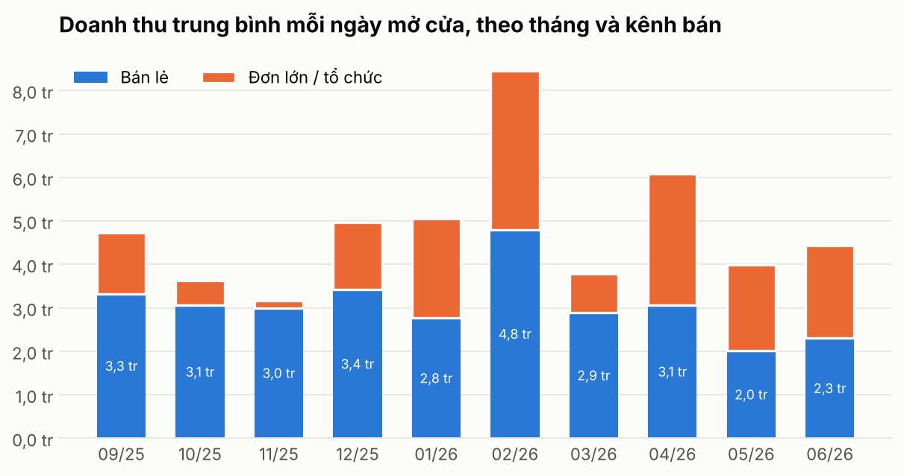
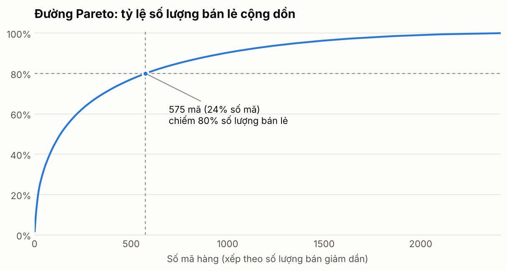
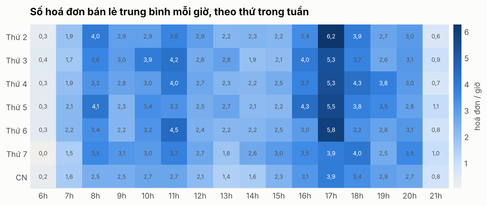
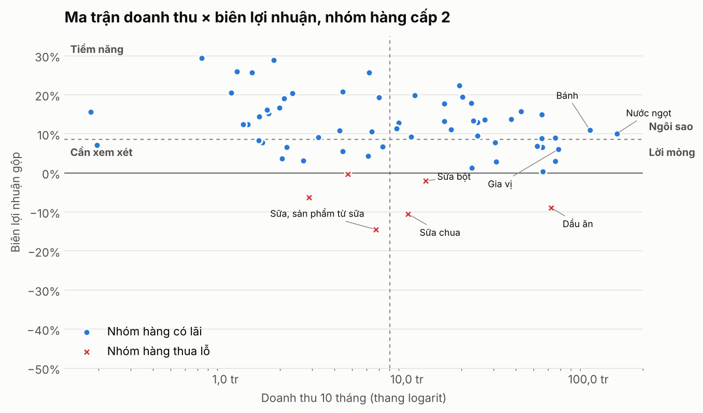
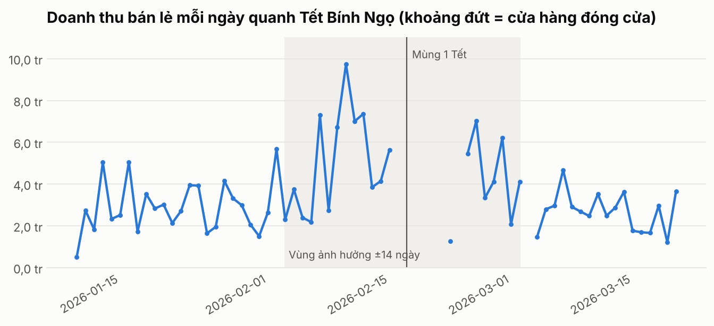

# Phân tích kinh doanh — Cửa hàng BHS Đại Phúc

_Sinh tự động bởi `python -m hasu.business_report` lúc 26/11/2026 08:16. Dữ liệu: 11/09/2025 – 30/06/2026. Mọi con số được truy vấn trực tiếp từ dữ liệu đã làm sạch (xem [báo cáo chất lượng dữ liệu](data_quality_report.md))._

**Nguyên tắc đo lường:** quyết định vận hành và tồn kho (nhập bao nhiêu, xếp ca) dùng **số lượng** và **số hoá đơn**; quyết định tài chính (định giá, chọn nhóm hàng) dùng **doanh thu** và **lợi nhuận**.

## Tóm tắt cho chủ cửa hàng

1. **Đơn lớn và đơn tổ chức chỉ chiếm 1,7% số hoá đơn nhưng mang về 36% doanh thu**, với biên lợi nhuận 7,1% (bán lẻ: 9,4%). Đây là một kênh bán riêng, cần được quản lý và dự báo riêng.
2. **Lượng khách bán lẻ giảm rõ trong tháng 5–6/2026**: từ khoảng 47 hoá đơn/ngày xuống 34 hoá đơn/ngày (-26%), trong khi giá trị mỗi hoá đơn gần như không đổi (66.555 đ → 63.259 đ). Nguyên nhân là **ít khách hơn**, không phải khách mua ít đi.
3. **6 nhóm hàng đang bán lỗ**, tập trung ở dầu ăn và các sản phẩm từ sữa. Riêng HASUKOOK dầu đậu nành NK Nga can 5L/3 (Can) được bán khoảng 200.000 đ trong khi giá vốn ghi nhận 280.000 đ, lỗ 5,6 triệu đ. Cần kiểm tra lại giá vốn hoặc giá bán.
4. **Tết làm tăng doanh thu bán lẻ 1,74 lần nhưng số lượng chỉ tăng 1,12 lần** trong 14 ngày trước Tết: khách mua hàng đắt hơn chứ không mua nhiều món hơn hẳn (phù hợp với giả thuyết mua quà biếu, thùng nước, bánh kẹo hộp, nhưng dữ liệu chưa kiểm chứng được).
5. **Cao điểm lúc 17h** (5,1 hoá đơn/giờ), thấp điểm 14h–15h. Chủ nhật vắng nhất (36 hoá đơn/ngày so với 45 các ngày khác).
6. **41 mã hàng được mua sỉ thường xuyên** (có đơn sỉ ở ít nhất một nửa số tháng), chủ yếu là nước uống, cà phê, trà, giấy và đồ vệ sinh. Mô hình chỉ dự báo bán lẻ, nên với các mã này cần giữ thêm khoảng một đơn sỉ điển hình làm dự phòng (mục 8).

## 1. Xu hướng doanh thu và lợi nhuận

Biểu đồ dùng **doanh thu trung bình mỗi ngày mở cửa** thay cho tổng tháng, vì tháng 09/2025 chỉ có dữ liệu từ ngày 11 và tháng 02/2026 nghỉ Tết 7 ngày. So tổng tháng sẽ cho kết luận sai.

| Tháng | Bán lẻ / ngày | Biên bán lẻ | Đơn lớn, tổ chức / ngày | Hoá đơn bán lẻ / ngày | Giá trị / hoá đơn |
|---|---|---|---|---|---|
| 2025-09 | 3,3 triệu đ | 16,8% | 1,4 triệu đ | 43 | 78.014 đ |
| 2025-10 | 3,1 triệu đ | 13,2% | 0,6 triệu đ | 52 | 59.377 đ |
| 2025-11 | 3,0 triệu đ | 11,7% | 0,2 triệu đ | 51 | 59.368 đ |
| 2025-12 | 3,4 triệu đ | 8,9% | 1,5 triệu đ | 52 | 66.470 đ |
| 2026-01 | 2,8 triệu đ | 9,8% | 2,3 triệu đ | 41 | 68.053 đ |
| 2026-02 | 4,8 triệu đ | 4,7% | 3,7 triệu đ | 41 | 117.252 đ |
| 2026-03 | 2,9 triệu đ | 2,9% | 0,9 triệu đ | 45 | 64.799 đ |
| 2026-04 | 3,1 triệu đ | 6,1% | 3,0 triệu đ | 44 | 69.804 đ |
| 2026-05 | 2,0 triệu đ | 11,4% | 2,0 triệu đ | 33 | 62.763 đ |
| 2026-06 | 2,3 triệu đ | 11,7% | 2,1 triệu đ | 36 | 63.755 đ |

**Nhận xét.** Doanh thu bán lẻ ổn định quanh 3,1 triệu đ/ngày từ tháng 9 đến tháng 4 (trừ tháng Tết), rồi giảm còn 2,2 triệu đ/ngày trong tháng 5–6. Số hoá đơn mỗi ngày giảm tương ứng trong khi giá trị mỗi hoá đơn không đổi, nên sụt giảm đến từ **lượng khách**. Dữ liệu bán hàng không cho biết lý do (mùa hè, đối thủ mới, thay đổi giờ mở cửa...): **cần chủ cửa hàng xác nhận**.

**Khách lẻ giảm có phải vì chuyển sang mua đơn lớn?** Số đơn lớn và đơn tổ chức tăng từ 7 đơn/tháng (tháng 9–11/2025) lên 23 đơn/tháng ngay từ tháng 1–4/2026, tức trước khi khách lẻ giảm; trong tháng 5–6 số đơn lớn gần như giữ nguyên (28 đơn/tháng). Số hoá đơn bán lẻ từ 500 nghìn đồng trở lên cũng không giảm bất thường, nên không thấy dấu hiệu khách lẻ mua gom vượt ngưỡng đơn lớn. Sụt giảm tập trung ở khung **chiều tối 16h–21h (-42%)**, còn buổi sáng chỉ -10% và buổi trưa -16%. Điều này gợi ý nguyên nhân bên ngoài tác động tới khách mua sau giờ làm (cửa hàng mới gần đó, thay đổi giờ mở cửa, mùa hè...), cần chủ cửa hàng xác nhận.

Biên lợi nhuận bán lẻ tụt thấp trong tháng 2–4/2026. Các khoản lỗ lớn nhất trong giai đoạn này nằm ở giặt giũ (tháng 2), thực phẩm ăn liền (tháng 3–4) và sữa chua: phù hợp với việc bán xả hàng cận hạn hoặc giá vốn nhập tăng mà giá bán chưa điều chỉnh.

## 2. Phân loại ABC theo số lượng bán lẻ

| Nhóm | Số mã | Tỷ lệ số mã | Tỷ lệ số lượng | Tỷ lệ doanh thu bán lẻ | Trung vị % ngày có bán |
|---|---|---|---|---|---|
| A | 575 | 23,8% | 80,0% | 54,5% | 6,4% |
| B | 778 | 32,2% | 15,0% | 28,0% | 2,5% |
| C | 1.061 | 44,0% | 5,0% | 17,5% | 0,7% |

**Nhận xét.** 575 mã hàng nhóm A (24% số mã) chiếm 80% số lượng bán lẻ. Tuy vậy, ngay cả trong nhóm A, trung vị mỗi mã chỉ bán ra ở 6% số ngày. Vì vậy dự báo cho **từng mã** theo ngày vẫn rất nhiễu, và mô hình sẽ dự báo ở **cấp nhóm hàng** trước.

| # | Mã hàng | Số lượng | % ngày có bán |
|---|---|---|---|
| 1 | Nước khoáng Lavie 0.35L (Chai) | 987 | 17,4% |
| 2 | Hảo hảo hương vị mì tôm chua cay 75G/30 - gói (Gói) | 809 | 28,1% |
| 3 | Sua Lua Mach NESTLE MILO 12(4x180ml) Moi (Hộp) | 784 | 25,3% |
| 4 | Thuốc lá Thăng Long Mềm (Bao) | 745 | 74,0% |
| 5 | Nước khoáng Lavie 0.5L (Chai) | 729 | 29,2% |
| 6 | Sài gòn dưa lưới (Bao) | 711 | 70,1% |
| 7 | Nước I - on Mira 360ml (Chai) | 609 | 9,6% |
| 8 | Nước Mira pH9 550ml (Chai) | 571 | 30,6% |
| 9 | Nước tăng lực Redbull (Lon) | 540 | 65,5% |
| 10 | Bia lon Saigon Lager 330ml (Lon) | 505 | 19,6% |

## 3. Mẫu hình theo giờ và thứ

- **Ba khung cao điểm**: 17h (cao nhất), 18h và 11h. Các khung này có thể tương ứng với giờ tan làm, giờ chuẩn bị bữa tối và trước bữa trưa, nhưng dữ liệu bán hàng không xác nhận được nguyên nhân. Buổi sáng còn một đỉnh phụ lúc 8h (3,5 hoá đơn/giờ).
- **Thấp điểm** 13h–15h (2,1–2,4 hoá đơn/giờ, thấp nhất lúc 14h).
- **Chủ nhật** vắng hơn rõ rệt (36 hoá đơn/ngày).

**Khuyến nghị xếp ca:** bố trí đủ người đứng quầy 16h–19h và 8h–12h; dùng khung 13h–15h để nhận hàng, kiểm kho, sắp xếp kệ.

## 4. Biên lợi nhuận theo nhóm hàng

Hai đường chia: doanh thu trung vị giữa các nhóm (8,1 triệu đ) và biên lợi nhuận chung của cửa hàng (8,6%).

| Phân nhóm | Số nhóm hàng | Tỷ trọng doanh thu | Lợi nhuận gộp |
|---|---|---|---|
| Ngôi sao | 21 | 57,2% | 93,5 triệu đ |
| Lời mỏng | 8 | 29,1% | 17,2 triệu đ |
| Tiềm năng | 20 | 4,0% | 9,3 triệu đ |
| Cần xem xét | 9 | 2,1% | 1,6 triệu đ |
| Thua lỗ | 6 | 7,6% | -8,0 triệu đ |

**Nhóm thua lỗ:**

| Nhóm hàng | Doanh thu | Lợi nhuận gộp | Biên |
|---|---|---|---|
| Dầu ăn | 62,3 triệu đ | -5,5 triệu đ | -8,9% |
| Sữa chua | 10,2 triệu đ | -1,1 triệu đ | -10,5% |
| Sữa, sản phẩm từ sữa | 6,7 triệu đ | -1,0 triệu đ | -14,5% |
| Sữa bột | 12,7 triệu đ | -0,3 triệu đ | -2,1% |
| Nui, mì, bún khô | 2,9 triệu đ | -0,2 triệu đ | -6,2% |
| Rau, củ | 4,7 triệu đ | -0,0 triệu đ | -0,3% |

**Nhận xét.**

- 21 nhóm "ngôi sao" (nước ngọt, bánh, trà, snack, thuốc lá...) tạo 57% doanh thu với biên cao hơn mức chung: đây là nhóm cần **không bao giờ để hết hàng**.
- 8 nhóm "lời mỏng" như gia vị, vệ sinh nhà cửa, giặt giũ chiếm 29% doanh thu nhưng biên rất thấp ở cả bán lẻ lẫn đơn lớn. Nên xem lại giá bán (lẻ và sỉ) cho các nhóm này.
- **Dầu ăn** lỗ nặng nhất (-5,5 triệu đ), chủ yếu do một mã dầu đậu nành can 5 lít bán thấp hơn giá vốn ghi nhận. Ngành **sữa** có 3/6 nhóm cấp 2 đang lỗ nhẹ; chỉ sữa nước các loại, sữa đặc, sản phẩm từ sữa khác còn có lãi. Sữa có hạn dùng ngắn, nên một khả năng là xả hàng cận hạn: đây là nhóm cần dự báo sát để giảm hàng dư.
- **103 dòng có giá vốn lớn hơn 3 lần giá bán** (ví dụ kẹo mút bán 1.000 đ nhưng giá vốn ghi 52.920 đ là giá cả túi 58 que; sữa Milo bán theo hộp nhưng giá vốn ghi theo lốc 4 hộp) được coi là nhập sai đơn vị và không tính vào lợi nhuận. Nếu tính, chúng tạo ra khoản "lỗ" giả 15,8 triệu đ trên doanh thu chỉ 4,3 triệu đ, làm sữa bột và sữa nước trông như đang lỗ nặng.
- **Hạn chế:** giá vốn lấy từ KiotViet tại thời điểm bán. Giá vốn sai ở mức nhỏ hơn (ví dụ dầu ăn 1,4 lần giá bán) không phát hiện được bằng quy tắc trên, nên các nhóm thua lỗ cần chủ cửa hàng đối chiếu hoá đơn nhập trước khi quyết định.

## 5. Ảnh hưởng của Tết

| Giai đoạn | Số ngày mở cửa | Hệ số số lượng | Hệ số doanh thu |
|---|---|---|---|
| Trước Tết | 13 | 1,12 lần | 1,74 lần |
| Sau Tết | 8 | 1,13 lần | 1,46 lần |

Hệ số = trung bình mỗi ngày mở cửa trong giai đoạn / trung bình các ngày mở cửa ngoài vùng ảnh hưởng. "Trước Tết" là 14 ngày trước mùng 1 (17/02/2026); "Sau Tết" là 14 ngày kể từ mùng 1 (phần lớn cửa hàng nghỉ).

**Nhóm hàng tăng mạnh nhất 14 ngày trước Tết (theo doanh thu):**

| Nhóm hàng cấp 1 | Hệ số doanh thu | Hệ số số lượng |
|---|---|---|
| Thủ công | 34,84 lần | 2,31 lần |
| Bánh, kẹo, snack | 3,26 lần | 1,41 lần |
| Đồ uống | 2,27 lần | 1,55 lần |
| Gạo, bột và thực phẩm khô | 1,52 lần | 0,91 lần |
| Chăm sóc nhà cửa | 1,48 lần | 1,39 lần |
| Thuốc lá | 1,06 lần | 1,05 lần |

**Nhận xét.** Trước Tết, doanh thu tăng mạnh hơn nhiều so với số lượng. Điều này khẳng định nguyên tắc dùng đúng thước đo: nếu nhập hàng Tết theo hệ số doanh thu 1,74 lần, cửa hàng sẽ nhập dư gần gấp rưỡi so với nhu cầu thực tế về số lượng. Với dự báo nhập hàng, dùng **hệ số số lượng theo từng nhóm hàng**. **Giới hạn:** dữ liệu chỉ có một kỳ Tết, nên các hệ số này là một lần quan sát và sẽ được cập nhật khi có thêm dữ liệu.

## 6. Phân tích giỏ hàng

Thuật toán FP-Growth (cùng kết quả với Apriori, chạy nhanh hơn) trên 4.580 hoá đơn bán lẻ có từ 2 nhóm hàng trở lên, **đã loại các dòng bán dưới 95% giá phổ biến** để luật phản ánh hành vi mua tự nhiên chứ không phải tác động của khuyến mãi. Phân tích ở nhóm hàng cấp 3 vì từng mã hàng quá thưa.

- **Độ tin cậy (confidence)**: trong các hoá đơn có A, bao nhiêu % có cả B.
- **Lift**: khả năng mua B khi đã mua A cao gấp bao nhiêu lần so với bình thường. Lift > 1 là có liên kết.

| Nếu mua | Thì thường mua | Số hoá đơn | Độ tin cậy | Lift |
|---|---|---|---|---|
| Dụng cụ bếp khác | Thuốc lá | 65 | 77,4% | 8,32 |
| Mì ăn liền | Mì, bún, phở, cháo ăn liên, bánh gạo | 162 | 53,6% | 2,99 |
| Kẹo Tổng Hợp | Kẹo | 86 | 43,0% | 2,77 |
| Trà, Cà phê, cacao | Thuốc lá | 48 | 22,6% | 2,43 |
| Lạp xưởng, xúc xích ăn liền | Mì, bún, phở, cháo ăn liên, bánh gạo | 190 | 43,0% | 2,39 |
| Bánh, kẹo, snack | Snack các loại | 64 | 31,8% | 2,27 |
| Snack Bim bim | Snack các loại | 121 | 30,2% | 2,16 |
| Mì ăn liền | Lạp xưởng, xúc xích ăn liền | 57 | 18,9% | 1,96 |
| Thuốc lá | Nước giải khát | 225 | 52,8% | 1,65 |
| Trà, Cà phê, cacao | Nước giải khát | 102 | 48,1% | 1,50 |

**Đọc kết quả cẩn thận:** một số luật có lift cao nhưng thực chất là **cùng một loại hàng bị chia làm hai nhóm** trong KiotViet: `Mì ăn liền` và `Mì, bún, phở, cháo ăn liền`, `Kẹo Tổng Hợp` và `Kẹo`, `Snack Bim bim` và `Snack các loại`. Đây là dấu hiệu cây nhóm hàng cần gộp lại, không phải hành vi mua kèm. Các khuyến nghị dưới đây chỉ dựa trên những cặp khác loại hàng.

**Khuyến nghị combo và bày kệ:**

- `Dụng cụ bếp khác → Thuốc lá` có lift cao nhất. Kiểm tra cho thấy nhóm này thực chất là **bật lửa**, bị xếp nhầm nhóm hàng. Nên chuyển bật lửa về cạnh quầy thuốc lá, đồng thời sửa nhóm hàng trong KiotViet.
- **Mì + xúc xích/lạp xưởng ăn liền**: combo "bữa ăn nhanh". Đặt hai nhóm cạnh nhau, hoặc bán kèm giá combo.
- **Thuốc lá + nước giải khát**, **trà/cà phê + nước giải khát**: đặt tủ nước gần quầy thu ngân.
- **Sữa tươi + bánh**: combo bữa sáng cho khung 7h–9h.

## 7. Nghi ngờ hết hàng (nhu cầu không được đáp ứng)

Xét 81 mã hàng bán đều (có bán ở ≥ 15% số ngày mở cửa). Với mỗi mã, nếu một chuỗi từ 5 ngày mở cửa liên tiếp trở lên không bán được có xác suất xảy ra ngẫu nhiên dưới 1%, chuỗi đó bị đánh dấu nghi ngờ hết hàng.

- **72/81 mã** có ít nhất một giai đoạn nghi ngờ, tổng cộng 129 giai đoạn.
- **27 mã** ngừng bán hẳn tới cuối kỳ dữ liệu (có thể do đang hết hàng hoặc đã ngừng kinh doanh).

| Mã hàng | Từ | Đến | Số ngày mở cửa không bán | % ngày có bán (bình thường) | Đánh giá |
|---|---|---|---|---|---|
| Bánh da trứng cuộn kem tươi chà bông 84g (Gói) | 25/12/2025 | 30/06/2026 | 176 | 18,9% | Không bán tới cuối kỳ: hết hàng hoặc đã ngừng bán |
| Kẹo sing-gum CAME ly 150 gói 2 viên (Cái) | 05/01/2026 | 19/06/2026 | 154 | 18,5% | Nghi ngờ hết hàng |
| Bánh mỳ chà bông Staff 60g/60 (Gói) | 28/01/2026 | 30/06/2026 | 142 | 27,2% | Không bán tới cuối kỳ: hết hàng hoặc đã ngừng bán |
| Muối chấm hảo hảo tôm chua cay 120g/24h (Lọ) | 08/03/2026 | 30/06/2026 | 111 | 16,7% | Không bán tới cuối kỳ: hết hàng hoặc đã ngừng bán |
| Nước 7 up Rivive 500ml/24 (Chai) | 02/03/2026 | 17/06/2026 | 103 | 15,7% | Nghi ngờ hết hàng |
| Kem MOCHI (Cái) | 26/12/2025 | 06/04/2026 | 94 | 16,4% | Nghi ngờ hết hàng |
| Nước trà xanh C2 hương chanh 455ml/24 (Chai) | 04/04/2026 | 30/06/2026 | 84 | 31,0% | Không bán tới cuối kỳ: hết hàng hoặc đã ngừng bán |
| Cà Phê Sữa Đá Highlands BÉ (185ml/Lon) (Lon) | 03/12/2025 | 26/02/2026 | 79 | 22,8% | Nghi ngờ hết hàng |
| Kẹo Mút CC Hỗn Hợp 18Gói x 558g (60v) (Cái) | 09/04/2026 | 30/06/2026 | 79 | 23,6% | Không bán tới cuối kỳ: hết hàng hoặc đã ngừng bán |
| Nước hồng trà C2 vị đào chai 455ml/24 (Chai) | 14/04/2026 | 30/06/2026 | 75 | 24,5% | Không bán tới cuối kỳ: hết hàng hoặc đã ngừng bán |

**Hệ quả cho mô hình:** các giai đoạn này là **dữ liệu bị kiểm duyệt** (censored), tức nhu cầu có nhưng không bán được vì không có hàng, chứ không phải nhu cầu bằng 0. Khi dự báo ở cấp nhóm hàng, khách thường mua mã khác trong cùng nhóm, nên ảnh hưởng nhỏ hơn nhiều so với cấp mã hàng.

**Giới hạn:** đây là suy đoán từ dữ liệu bán. Hàng theo mùa (ví dụ kem vào mùa đông) và hàng ngừng kinh doanh cũng có biểu hiện giống hệt. Danh sách đầy đủ có trong ứng dụng để chủ cửa hàng xác nhận từng trường hợp.

## 8. Mặt hàng hay được mua sỉ

Mô hình dự báo chỉ dự báo kênh bán lẻ (xem báo cáo dự báo), vì đơn sỉ đến bất chợt và mỗi đơn rất lớn. Mục này trả lời câu hỏi còn lại: **những mặt hàng nào khách sỉ hay mua, mỗi lần khoảng bao nhiêu**, để cửa hàng giữ thêm hàng dự phòng ngoài phần dự báo bán lẻ. Đơn sỉ ở đây gồm đơn lớn và đơn của tổ chức; mỗi mã trong một hoá đơn sỉ tính là một lần mua.

Phân loại theo số tháng có đơn sỉ trên 10 tháng dữ liệu: **thường xuyên** là có đơn sỉ ở ít nhất một nửa số tháng (từ 5 tháng trở lên), **thỉnh thoảng** là từ 2 lần mua trở lên nhưng chưa đủ nửa số tháng, **một lần** là chỉ được mua sỉ đúng một lần. Ngưỡng một nửa số tháng là lựa chọn của người phân tích để chủ cửa hàng dễ kiểm tra lại, không phải ngưỡng chuẩn.

| Mức độ | Số mã | Số lần mua sỉ | Tỷ trọng doanh thu sỉ |
|---|---|---|---|
| Thường xuyên | 41 | 385 | 35,9% |
| Thỉnh thoảng | 173 | 448 | 41,4% |
| Một lần | 338 | 338 | 22,7% |

**41 mã được mua sỉ thường xuyên** (các mã có số tháng nhiều nhất):

| Mã hàng | Nhóm hàng cấp 3 | Số tháng có đơn sỉ | Số lần mua | SL mỗi lần (trung vị) | % SL bán qua kênh sỉ | Dự phòng gợi ý |
|---|---|---|---|---|---|---|
| Bánh Kenju Kem dẻo 186g (Túi) | Bánh Tổng Hợp | 9 | 16 | 33,5 | 97% | 34 |
| Hasu Giấy ăn rút cao cấp gói 500 tờ/5x8 (Gói) | Chăm Sóc Cá Nhân Hasu | 9 | 16 | 50 | 83% | 50 |
| Cà phê G7 2in1 - Hộp 15st 16g (24hộp/t) (Hộp) | Trà, Cà phê, cacao | 9 | 12 | 5,5 | 79% | 6 |
| NRC SUTIKI Hương quế 3.6KG (Can) | Nhóm Tẩy Rửa Hasu | 9 | 9 | 3 | 79% | 3 |
| Bánh Gạo An-Chà Bông14P_04Y23/10-Gói (Gói) | Bánh Tổng Hợp | 8 | 15 | 29 | 96% | 29 |
| Cà phê G7 3in1 - Hộp 18 gói 16gr (Hộp) | Trà, Cà phê, cacao | 8 | 10 | 14 | 69% | 14 |
| Cà phê G7 3in1 - Hộp 21 (Hộp) | Trà, Cà phê, cacao | 8 | 10 | 10 | 70% | 10 |
| Trà gừng Hot Ginger ( Nhãn hiệu Cozy) (20gói *10g) (Hộp) | Trà | 8 | 10 | 2 | 75% | 2 |
| Sữa đặc Ông Thọ tuýp 165gr/24 (Tuýp) | Sữa đặc | 8 | 9 | 5 | 61% | 5 |
| Nước Mira pH9 550ml (Chai) | Nước Ion | 7 | 16 | 48 | 65% | 48 |
| Đồ uống Coke 300ml 4x6 PetSF Tet Entry (Chai) | Nước giải khát | 7 | 12 | 72 | 95% | 72 |
| Kẹo Oishi-85g (Gói(Thập Cẩm)) | Kẹo | 7 | 12 | 30 | 93% | 30 |
| NESCAFE 3in1 Rang Dam Hop 24(18x16g) MYW (Hộp) | Trà, Coffee | 7 | 10 | 3 | 75% | 3 |
| Khăn Giấy Rút Gấu Cao Cấp Hasu 300 Tờ (Gói) | Chăm Sóc Cá Nhân Hasu | 7 | 10 | 30 | 54% | 30 |
| Túi bóng rác 20kg (Kg) | Đồ dùng một lần | 7 | 10 | 4,5 | 62% | 5 |

**Nhận xét.**

- Khách sỉ mua lặp lại một nhóm hàng khá ổn định: 19/41 mã thường xuyên là đồ uống (nước khoáng, nước ion, nước ngọt, cà phê, trà), số còn lại chủ yếu là giấy ăn, giấy vệ sinh, túi rác, cốc giấy và nước tẩy rửa. Đây là những thứ thường dùng cho văn phòng, tiếp khách và vệ sinh; dữ liệu không có thông tin khách nên đây chỉ là nhận định từ loại hàng.
- Ở 35/41 mã thường xuyên, **hơn một nửa số lượng bán ra đi qua kênh sỉ** (trung vị 69%). Nếu chỉ nhập theo dự báo bán lẻ, các mã này rất dễ thiếu khi có đơn sỉ.
- Số đơn sỉ mỗi tháng tăng dần: 8 đơn/tháng trong tháng 9–11/2025, lên 31 đơn/tháng trong tháng 4–6/2026, nên nhu cầu dự phòng có xu hướng tăng.
- Giữ sẵn một đơn sỉ điển hình (trung vị số lượng mỗi lần mua) cho 41 mã này cần khoảng **13,5 triệu đ vốn** tính theo giá vốn: một khoản nhỏ so với doanh thu sỉ 478,7 triệu đ trong kỳ.

- **Kiểm chứng ngoài mẫu:** áp đúng quy tắc trên cho 7 tháng đầu, rồi kiểm tra trên 3 tháng cuối. Quy tắc chọn ra 25 mã thường xuyên (dự phòng 10,0 triệu đ); 24/25 mã thật sự có đơn sỉ trở lại. Lượng dự phòng đáp ứng trọn 75% số lần mua sỉ và 88% số lượng của các mã này. Tuy vậy, các mã thường xuyên chỉ chiếm 9% tổng số lượng sỉ: phần lớn số lượng sỉ đến từ các đơn lớn một lần, vẫn phải nhập theo đơn đặt trước.
- **Đơn sỉ ở đây không chỉ là bán buôn:** một hoá đơn được xếp vào đơn lớn khi cả hoá đơn từ 100 sản phẩm hoặc 3 triệu đồng trở lên, nên các món mua ít đi kèm (2 hộp trà, 3 can nước rửa) của văn phòng, cơ quan cũng nằm trong đó. Với những món này lượng dự phòng rất nhỏ, gần như không ảnh hưởng tới vốn.

**Cách dùng:** lượng nhập = dự báo bán lẻ (ứng dụng) + dự phòng sỉ cho các mã thường xuyên. Mã thỉnh thoảng và một lần không giữ dự phòng, chỉ nhập khi khách đặt trước. Đơn sỉ lớn bất thường (số lượng lớn nhất có thể gấp nhiều lần trung vị) vẫn cần khách báo trước vài ngày.

**Giới hạn:** dữ liệu chỉ có 10 tháng và không có mã khách hàng, nên không biết các đơn lặp lại có phải cùng một khách hay không. Danh sách đầy đủ có trong ứng dụng (trang Phân tích, thẻ Mua sỉ).

## Khuyến nghị tổng hợp

| # | Khuyến nghị | Căn cứ | Ưu tiên |
|---|---|---|---|
| 1 | Đối chiếu giá vốn và giá bán các mã đang bán dưới giá vốn, bắt đầu với dầu ăn HASUKOOK; sửa 103 dòng giá vốn nhập sai đơn vị trong KiotViet | Mục 4: 6 nhóm hàng lỗ | Cao |
| 2 | Tìm hiểu nguyên nhân lượng khách bán lẻ giảm từ tháng 5 | Mục 1: hoá đơn/ngày giảm, giá trị/hoá đơn không đổi | Cao |
| 3 | Tách kế hoạch nhập hàng cho kênh đơn lớn khỏi bán lẻ; xem lại giá bán (lẻ và sỉ) nhóm lời mỏng | Tóm tắt 1, mục 4 | Trung bình |
| 4 | Ưu tiên không để hết hàng các nhóm ngôi sao; kiểm tra danh sách nghi ngờ hết hàng | Mục 4, mục 7 | Cao |
| 5 | Nhập hàng Tết theo hệ số số lượng từng nhóm, không theo hệ số doanh thu | Mục 5 | Theo mùa |
| 6 | Xếp ca theo cao điểm 16h–19h và 8h–12h; nhận hàng 13h–15h | Mục 3 | Thấp, làm ngay được |
| 7 | Bày bật lửa cạnh quầy thuốc lá, mì cạnh xúc xích | Mục 6 | Thấp, làm ngay được |
| 8 | Chuẩn hoá cây nhóm hàng trong KiotViet: sửa nhóm của bật lửa, gộp các nhóm trùng nghĩa (mì, kẹo, snack) | Báo cáo chất lượng dữ liệu, mục 4; mục 6 | Thấp, giúp mọi phân tích sau chính xác hơn |
| 9 | Giữ hàng dự phòng bằng khoảng một đơn sỉ điển hình cho 41 mã hay được mua sỉ; mã khác chỉ nhập khi khách đặt trước | Mục 8 | Trung bình |
