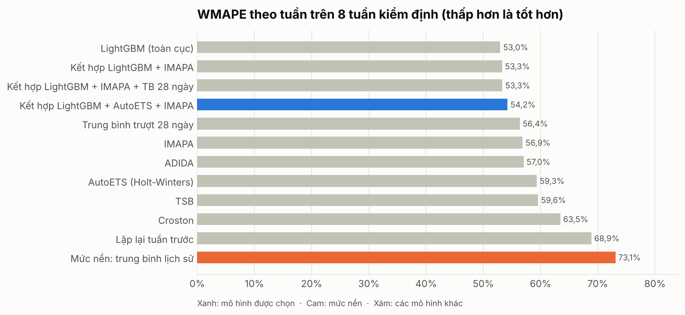
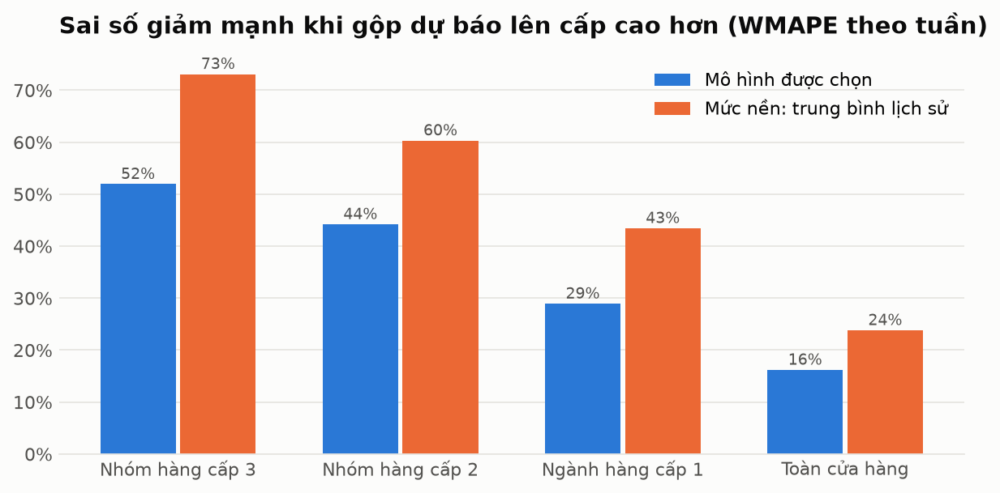
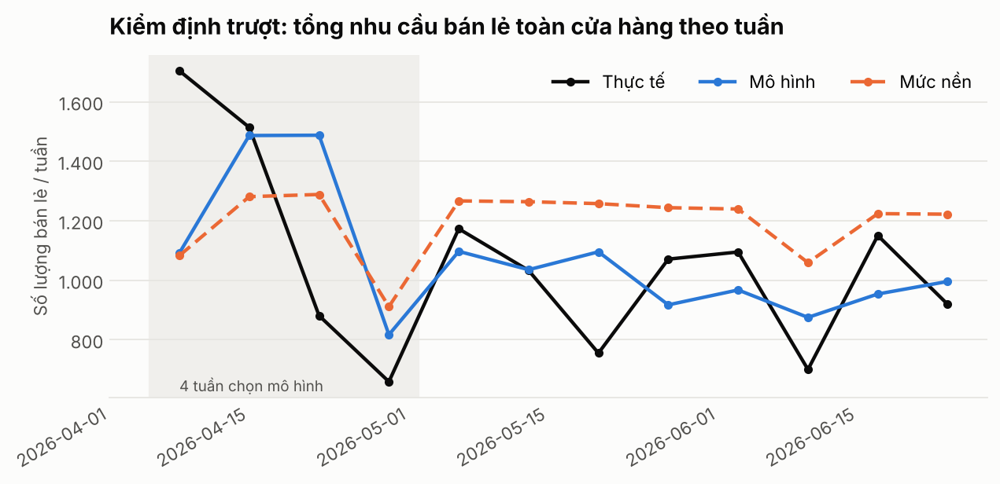
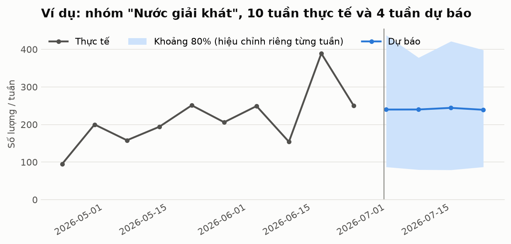
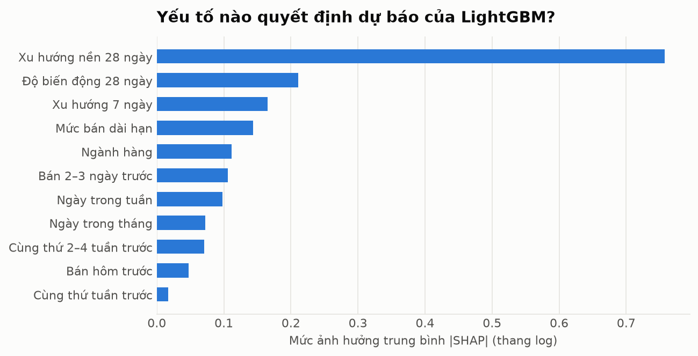

# Mô hình dự báo nhu cầu

_Sinh tự động bởi `python -m hasu.forecast_report` lúc 26/11/2026 08:41. Dữ liệu tới 30/06/2026._

## Kết quả chính

- **Mô hình được chọn:** Kết hợp LightGBM + AutoETS + IMAPA, chọn trên 4 tuần đầu của kiểm định, không nhìn vào 8 tuần dùng để chấm điểm.
- **Toàn cửa hàng:** sai số dự báo tuần (WMAPE) 14,5%, tức độ chính xác khoảng **85%**. Mức nền: 23,8%. Lưu ý: ở cấp này trung bình trượt 28 ngày còn tốt hơn mô hình (14,3%).
- **Nhóm hàng cấp 3** (đơn vị ra quyết định nhập hàng): WMAPE 54,2% so với 73,1% của mức nền, **giảm 26% sai số**. Độ lệch (bias) 0,5%, trong khi mức nền dự báo thừa 23,8%.
- **Kiểm định thống kê:** mô hình tốt hơn mức nền có ý nghĩa thống kê (Wilcoxon p = 0,001), nhưng chênh lệch với trung bình trượt 28 ngày **không có ý nghĩa thống kê** (Wilcoxon p = 0,90; Diebold–Mariano p = 0,24).
- **Mô phỏng nhập hàng 8 tuần có chuyển tồn** (hàng bảo quản lâu bán tiếp tuần sau, hàng dễ hư hỏng còn dư bị bỏ): nhập theo mô hình kết hợp phân vị có tổng chi phí (lợi nhuận mất do thiếu hàng + hàng hỏng + chi phí vốn) **6,8 triệu đ**, so với 7,9 triệu đ của cách nhẩm theo trung bình 28 ngày và 22,7 triệu đ của mức nền (mục 5).

**Nói thẳng về giới hạn:** chỉ 53% số nhóm hàng (46/87 nhóm) có sai số thấp hơn mức nền khi xét riêng từng nhóm, mô hình chỉ tốt hơn trung bình trượt 28 ngày một chút và không có ý nghĩa thống kê (54,2% so với 56,4%), ở cấp toàn cửa hàng còn kém trung bình trượt 28 ngày. Mức giảm 26% so với mức nền một phần là do lượng khách giảm khoảng một phần tư đúng trong 8 tuần chấm điểm (tháng 5–6/2026): trung bình lịch sử không theo kịp nên dự báo thừa 23,8%. Với dữ liệu thưa như cửa hàng này, không mô hình nào dự báo chính xác từng nhóm hàng nhỏ theo tuần. Giá trị thực tế nằm ở: (1) dự báo tổng và nhóm lớn đáng tin cậy, (2) chính sách nhập hàng theo phân vị, (3) giải thích được và tự động hoá được.

## 1. Dữ liệu đầu vào và phân loại nhu cầu

- Mục tiêu: **số lượng bán lẻ** theo ngày của từng nhóm hàng cấp 3, đã loại đơn lớn, đơn tổ chức, xuất nội bộ, hàng trả, hàng tặng (xem báo cáo chất lượng dữ liệu). Phần đơn sỉ được xử lý riêng bằng lượng dự phòng cho các mã hay được mua sỉ (báo cáo phân tích kinh doanh, mục 8).
- **Lớp ngày thường:** ngày đóng cửa và vùng 28 ngày quanh Tết (từ 14 ngày trước đến 13 ngày sau mùng 1) được thay bằng trung vị cùng thứ trong các tuần trước đó (không dùng tuần sau) trước khi huấn luyện, để mô hình học đường nền không bị đột biến kéo lệch. **Lớp ngày lễ:** khi kỳ dự báo rơi vào vùng Tết, dự báo được nhân hệ số số lượng theo ngành hàng (đo từ Tết 2026, xem báo cáo phân tích kinh doanh).
- Phân loại kiểu nhu cầu theo **Syntetos–Boylan** (ADI: khoảng cách trung bình giữa hai ngày có bán; CV²: độ biến động lượng bán):

| Kiểu nhu cầu | Số nhóm hàng | Tỷ trọng số lượng |
|---|---|---|
| Chưa đủ dữ liệu (dưới 20 ngày có bán) | 77 | 2,7% |
| Lumpy: bán gián đoạn, lượng dao động | 68 | 39,0% |
| Intermittent: bán gián đoạn, lượng đều | 25 | 3,6% |
| Erratic: bán gần như mọi ngày, lượng dao động | 10 | 54,8% |

Nhóm "chưa đủ dữ liệu" không được dự báo bằng mô hình: dùng trung bình 8 tuần gần nhất và gắn nhãn rõ trên ứng dụng (đề xuất nhập lô nhỏ thăm dò).

Bảng trên dùng toàn bộ dữ liệu, cho dự báo thật. Riêng **kiểm định** chỉ dùng dữ liệu tới trước cửa sổ đầu tiên (07/04/2026) để chọn nhóm đủ dữ liệu và xác định kiểu nhu cầu, nên có 87 nhóm hàng tham gia kiểm định.

## 2. Phương pháp kiểm định

**Kiểm định trượt theo thời gian (walk-forward):** 12 tuần cuối được chia thành 12 cửa sổ. Ở mỗi cửa sổ, mô hình chỉ thấy dữ liệu tới trước tuần đó, dự báo 7 ngày, rồi so với thực tế. **4 tuần đầu** dùng để chọn mô hình, **8 tuần sau** dùng để báo cáo. Tách hai giai đoạn để con số báo cáo không bị "đẹp giả" do chọn mô hình trên chính dữ liệu chấm điểm.

**Không nhìn trước:** mọi thông tin dùng trong kiểm định và mô phỏng chỉ lấy từ dữ liệu trước mốc cắt tương ứng: danh sách nhóm đủ dữ liệu và kiểu nhu cầu (trước cửa sổ đầu tiên); phân nhóm biên lợi nhuận để gán τ, giá vốn và giá bán (trước tuần chấm điểm đầu tiên, chỉ dùng giá vốn thật); ngày đóng cửa được nội suy từ các tuần trước đó; dòng số lượng lớn được nhận diện bằng mức mua điển hình của các lần bán trước đó.

| Chỉ số | Ý nghĩa |
|---|---|
| WMAPE | Tổng sai số tuyệt đối / tổng thực tế. Dùng được khi có nhiều tuần bán bằng 0 (MAPE thì không) |
| MAE | Sai số tuyệt đối trung bình, theo đơn vị sản phẩm |
| MdAPE | Trung vị sai số %, chỉ trên các tuần có bán |
| Bias | Sai số có dấu: dương là dự báo thừa (chôn vốn), âm là dự báo thiếu (mất doanh thu) |
| Tracking signal | Sai số tích luỹ (dự báo − thực tế) / sai số trung bình, cùng dấu với Bias. Lớn hơn 4 về trị tuyệt đối: mô hình lệch hệ thống |
| Fill rate, service level | Tỷ lệ nhu cầu được đáp ứng; tỷ lệ tuần có nhu cầu mà không thiếu hàng (trong mô phỏng) |

## 3. So sánh mô hình

| Mô hình | WMAPE (4 tuần chọn) | WMAPE (8 tuần chấm) | MAE | MdAPE | Bias |
|---|---|---|---|---|---|
| LightGBM (toàn cục) | 65,0% | 53,0% | 6,01 | 52,9% | -6,3% |
| Kết hợp LightGBM + IMAPA | 65,0% | 53,3% | 6,04 | 53,8% | -2,2% |
| Kết hợp LightGBM + IMAPA + TB 28 ngày | 66,4% | 53,3% | 6,05 | 55,0% | -0,1% |
| Kết hợp LightGBM + AutoETS + IMAPA ✅ | 63,8% | 54,2% | 6,15 | 53,3% | 0,5% |
| Trung bình trượt 28 ngày | 71,1% | 56,4% | 6,40 | 60,1% | 4,1% |
| IMAPA | 66,4% | 56,9% | 6,45 | 58,6% | 2,0% |
| ADIDA | 66,0% | 57,0% | 6,47 | 58,1% | 2,9% |
| AutoETS (Holt-Winters) | 64,9% | 59,3% | 6,73 | 58,6% | 5,9% |
| TSB | 67,3% | 59,6% | 6,76 | 64,0% | -1,7% |
| Croston | 70,0% | 63,5% | 7,20 | 58,0% | 12,0% |
| Lặp lại tuần trước | 74,8% | 68,9% | 7,82 | 74,5% | -1,4% |
| Mức nền: trung bình lịch sử | 78,1% | 73,1% | 8,29 | 64,0% | 23,8% |

**Vì sao chọn mô hình kết hợp mà không chọn LightGBM** dù LightGBM có WMAPE thấp nhất trên 8 tuần chấm (53,0%)? Vì quyết định chọn chỉ được dựa trên 4 tuần đầu. Ở đó LightGBM đứng sau mô hình kết hợp. Mô hình được chọn xếp hạng 1 ở 4 tuần chọn và hạng 4 ở 8 tuần chấm (kém LightGBM 1,3 điểm %): không phải mô hình tốt nhất trên dữ liệu chấm điểm, nhưng gần như không lệch. Thứ hạng của các mô hình đứng đầu đảo qua lại giữa hai giai đoạn, cho thấy chênh lệch giữa chúng rất nhỏ so với dao động ngẫu nhiên (xem kiểm định bên dưới). Chọn lại theo kết quả chấm điểm là dùng dữ liệu kiểm tra để ra quyết định, làm con số báo cáo lạc quan hơn thực tế.

**Chênh lệch có ý nghĩa thống kê không?** Với mỗi nhóm hàng, lấy sai số tuyệt đối trung bình theo tuần của mô hình được chọn trừ của mô hình so sánh, rồi kiểm định trên các nhóm hàng (gộp theo nhóm để xử lý tương quan giữa các tuần):

| So với | Số nhóm | Tỷ lệ nhóm mô hình tốt hơn | Wilcoxon p | Diebold–Mariano p |
|---|---|---|---|---|
| Trung bình trượt 28 ngày | 87 | 46,0% | 0,899 | 0,241 |
| Mức nền: trung bình lịch sử | 87 | 59,8% | 0,001 | 0,002 |
| LightGBM (toàn cục) | 87 | 56,3% | 0,896 | 0,362 |

Mô hình tốt hơn mức nền có ý nghĩa thống kê (p < 0,05), nhưng **không** tốt hơn trung bình trượt 28 ngày hay LightGBM đơn lẻ một cách có ý nghĩa thống kê. Vì vậy không nên quảng bá mô hình là "chính xác hơn hẳn cách nhẩm"; giá trị của nó nằm ở chính sách nhập hàng (mục 5), giải thích và tự động hoá.

**Tracking signal theo nhóm hàng:** 25/87 nhóm có |TS| > 4 trên 8 tuần chấm, trong đó 21 nhóm dự báo thừa có hệ thống. Điều này khớp với việc lượng khách bán lẻ giảm trong tháng 5–6/2026: mô hình học từ các tháng trước nên chậm theo kịp đà giảm. Vòng lặp tự đánh giá (mục 8) dùng chính chỉ số này để cảnh báo và huấn luyện lại.

**Theo kiểu nhu cầu (8 tuần chấm, WMAPE):**

| Mô hình | erratic | lumpy | intermittent |
|---|---|---|---|
| Kết hợp LightGBM + IMAPA + TB 28 ngày | 38,8% | 70,3% | 94,4% |
| LightGBM (toàn cục) | 39,4% | 68,4% | 95,8% |
| Kết hợp LightGBM + IMAPA | 39,4% | 69,2% | 94,7% |
| Kết hợp LightGBM + AutoETS + IMAPA | 39,9% | 71,2% | 93,0% |
| Trung bình trượt 28 ngày | 40,0% | 76,4% | 95,7% |
| Croston | 42,0% | 88,5% | 124,8% |
| IMAPA | 42,4% | 74,1% | 94,4% |
| ADIDA | 42,4% | 74,9% | 92,2% |
| TSB | 44,9% | 76,7% | 101,2% |
| AutoETS (Holt-Winters) | 44,9% | 77,5% | 89,8% |
| Mức nền: trung bình lịch sử | 50,8% | 101,1% | 120,1% |
| Lặp lại tuần trước | 55,4% | 83,7% | 115,5% |

Nhóm erratic (bán gần như mọi ngày, chiếm phần lớn sản lượng) dự báo khá tốt. Nhóm lumpy và intermittent rất khó dự báo theo tuần, đúng với lý thuyết: lượng bán của chúng gần như ngẫu nhiên.

## 4. Dự báo phân tầng: sai số theo cấp gộp

| Cấp | Mô hình | Trung bình 28 ngày | Mức nền |
|---|---|---|---|
| Nhóm hàng cấp 3 | 54,2% | 56,4% | 73,1% |
| Nhóm hàng cấp 2 | 46,0% | 47,6% | 60,3% |
| Ngành hàng cấp 1 | 29,1% | 29,9% | 43,4% |
| Toàn cửa hàng | 14,5% | 14,3% | 23,8% |

Dự báo ở nhóm hàng cấp 3 được cộng lên các cấp trên (bottom-up), nên luôn khớp nhau. Sai số giảm mạnh khi gộp vì dao động ngẫu nhiên của các nhóm nhỏ triệt tiêu lẫn nhau. Đây là lý do ứng dụng hiển thị nhãn độ tin cậy cho từng dòng và khuyến nghị dùng dự báo ngành hàng cho kế hoạch vốn.

## 5. Từ dự báo tới số lượng nhập

Dự báo điểm là mức trung tâm. Nhập đúng bằng dự báo điểm thì khoảng một nửa số tuần sẽ thiếu hàng. Vì vậy số lượng đề xuất nhập = dự báo × hệ số phân vị τ, với τ chọn theo đặc điểm nhóm hàng. Đây là mắt xích nối phân tích biên lợi nhuận với mô hình:

| Loại nhóm hàng | Phân vị τ | Lý do |
|---|---|---|
| Ngôi sao | 0,80 | Biên cao, bán chạy: chi phí hết hàng cao hơn chi phí tồn dư |
| Dễ hư hỏng | 0,55 | Hạn dùng ngắn: hàng dư gây lỗ trực tiếp, cần cân bằng |
| Bảo quản lâu | 0,70 | Biên thấp, để được lâu: rủi ro tồn dư chủ yếu là chi phí vốn |

Hệ số phân vị được ước lượng bằng **conformal prediction** theo tỷ lệ: từ các tuần đã kiểm định, lấy phân vị τ của tỷ lệ thực tế/dự báo cho từng kiểu nhu cầu. Phương pháp này không giả định phân phối chuẩn, phù hợp với nhu cầu gián đoạn. Hệ số dùng trong ứng dụng được ước lượng sau khi đã chốt mô hình; mô phỏng dưới đây dùng hệ số chỉ ước lượng từ 4 tuần chọn.

**Khoảng dự báo cho 4 tuần tới được hiệu chỉnh riêng từng tuần:** tuần 1 dùng 12 tuần kiểm định; tuần 2–4 dùng một kiểm định trượt riêng với chân trời 28 ngày (9 mốc cắt). Hệ số q10 và q90 theo tuần dự báo:

| Kiểu nhu cầu | Tuần 1 | Tuần 2 | Tuần 3 | Tuần 4 |
|---|---|---|---|---|
| erratic | 0,35 – 1,75 | 0,32 – 1,55 | 0,31 – 1,69 | 0,34 – 1,68 |
| intermittent | 0,00 – 3,22 | 0,00 – 2,81 | 0,00 – 3,00 | 0,00 – 2,93 |
| lumpy | 0,00 – 2,34 | 0,00 – 2,14 | 0,00 – 1,93 | 0,00 – 1,94 |

Khoảng tương đối gần như không rộng ra theo tuần, vì sai số chủ yếu là dao động ngẫu nhiên từ tuần này sang tuần khác chứ không cộng dồn; nhưng mức giữa giảm dần ở tuần xa hơn, tức dự báo xa dễ thừa hơn trong giai đoạn khách giảm. Khoảng của nhóm gián đoạn rộng vì gộp chung nhiều nhóm hàng có biến động khác nhau; đây là cái giá của việc có quá ít tuần dữ liệu cho từng nhóm.

**Mô phỏng nhập hàng trên 8 tuần chấm điểm.** Mọi tham số (hệ số phân vị, τ, giá vốn, giá bán) chỉ lấy từ dữ liệu trước tuần chấm điểm đầu tiên. Số lượng đặt được làm tròn lên như trong ứng dụng. Service level chỉ tính trên các tuần có nhu cầu.

*(a) Nhiều kỳ, có chuyển tồn* (gần thực tế hơn): mỗi tuần đặt lên mức mục tiêu = số lượng của chính sách trừ tồn đầu tuần; hàng bảo quản lâu còn dư bán tiếp tuần sau, chịu chi phí vốn 1%/tháng; hàng dễ hư hỏng còn dư bị bỏ. Hàng thiếu quy ra lợi nhuận gộp bị mất.

| Cách nhập | Tổng đặt | Hàng thiếu | Fill rate | Service level | Lợi nhuận mất | Hàng hỏng | Chi phí vốn | Tổng chi phí |
|---|---|---|---|---|---|---|---|---|
| Mức nền: trung bình lịch sử | 7.821 | 1.869 | 76,3% | 73,3% | 3,1 triệu đ | 19,5 triệu đ | 0,1 triệu đ | 22,7 triệu đ |
| Trung bình 28 ngày (cách nhẩm) | 6.750 | 1.908 | 75,8% | 63,5% | 3,0 triệu đ | 4,8 triệu đ | 0,1 triệu đ | 7,9 triệu đ |
| Mô hình: dự báo điểm | 6.679 | 1.977 | 75,0% | 66,7% | 3,1 triệu đ | 6,6 triệu đ | 0,1 triệu đ | 9,8 triệu đ |
| Mô hình + phân vị theo nhóm hàng | 6.988 | 1.639 | 79,2% | 67,8% | 2,4 triệu đ | 4,4 triệu đ | 0,1 triệu đ | 6,8 triệu đ |

Có chuyển tồn, chính sách phân vị **tốt hơn cách nhẩm theo trung bình 28 ngày ở các chỉ số chính**: hàng thiếu giảm 14%, lợi nhuận mất giảm 21%, giá trị hàng hỏng giảm 10%, tổng chi phí giảm 13%; chỉ chi phí vốn nhỉnh hơn vì giữ nhiều hàng hơn. Mức nền có tổng chi phí cao nhất vì dự báo thừa nhiều, làm hỏng hàng dễ hư.

*(b) Một kỳ, không chuyển tồn* (giả định bi quan: mọi hàng dư coi như mất trọn giá vốn):

| Cách nhập | Tổng nhập | Hàng thiếu | Hàng dư | Fill rate | Service level | Giá trị hàng dư |
|---|---|---|---|---|---|---|
| Mức nền: trung bình lịch sử | 10.136 | 1.871 | 4.111 | 76,3% | 73,3% | 65,8 triệu đ |
| Trung bình 28 ngày (cách nhẩm) | 8.490 | 1.970 | 2.564 | 75,0% | 61,3% | 40,5 triệu đ |
| Mô hình: dự báo điểm | 8.313 | 2.014 | 2.431 | 74,5% | 65,4% | 42,3 triệu đ |
| Mô hình + phân vị theo nhóm hàng | 9.762 | 1.686 | 3.552 | 78,6% | 66,1% | 52,1 triệu đ |

- So với **mức nền**: hàng thiếu giảm 10%, giá trị hàng dư giảm 21%.
- So với **trung bình 28 ngày**: hàng thiếu giảm 14% nhưng hàng dư tăng 29%. Giả định này tính mọi hàng dư là mất trắng, kể cả nước ngọt hay hàng khô, nên phóng đại chi phí của việc nhập dư; vì vậy mô phỏng (a) là căn cứ chính.
- **Service level** của chính sách phân vị (67,8% ở mô phỏng a) vẫn thấp hơn mức nền (73,3%): mức nền dự báo thừa đều nên ít tuần thiếu, đổi lại hàng hỏng nhiều nhất. Chính sách phân vị giảm tổng *lượng* hàng thiếu hơn là số tuần có thiếu hàng.
- **Còn thiếu so với thực tế:** chưa có tồn kho đầu kỳ thật, thời gian giao hàng và quy cách đóng thùng (phải đặt theo bội số thùng/lốc). Khi áp dụng thật: lượng đặt = max(0, mức mục tiêu − tồn hiện có), làm tròn lên theo quy cách thùng.

## 6. Giải thích dự báo bằng SHAP

SHAP phân rã mỗi dự báo của LightGBM thành đóng góp của từng yếu tố. Lưu ý: SHAP chỉ giải thích thành phần LightGBM, một trong ba mô hình của tổ hợp, nên phản ánh xu hướng chính của dự báo chứ không phân rã chính xác con số đề xuất cuối cùng. LightGBM dùng hàm mục tiêu Tweedie (hợp với số đếm nhiều số 0), nên dự báo nằm trên thang log. Vì vậy trong ứng dụng, đóng góp được đổi thành **% tác động**, ví dụ "ngày Chủ nhật làm dự báo giảm 12%".

- Ba yếu tố quan trọng nhất: **Xu hướng nền 28 ngày**, **Độ biến động 28 ngày**, **Xu hướng 7 ngày**. Mô hình dựa chủ yếu vào mức bán gần đây, tức hành vi giống một trung bình trượt thông minh, cộng thêm hiệu chỉnh theo ngày trong tuần và ngành hàng.
- **Khuyến mãi không được đưa vào mô hình chính.** Giá bán trong dữ liệu chỉ quan sát được ở ngày có bán, nên dùng nó làm biến dự báo sẽ làm rò rỉ thông tin "hôm đó có bán". Ảnh hưởng của giảm giá được ước lượng riêng cho phần kịch bản (mục 7).

## 7. Kịch bản mô phỏng: giảm giá

Ước lượng sơ bộ: trong các ngày có bán, lượng bán ngày có chiết khấu trên 5% so với ngày bình thường (đã chuẩn hoá theo mức bán của từng nhóm hàng). Mỗi lượt là một nhóm hàng cấp 3 trong một ngày.

| Ngành hàng | Số lượt nhóm hàng × ngày có chiết khấu | Chiết khấu TB | Lượng bán / ngày thường | Đủ tin cậy (≥ 30 lượt) |
|---|---|---|---|---|
| Sữa, sản phẩm từ sữa | 129 | 20,5% | 1,96 lần | Có |
| Đồ uống | 103 | 13,4% | 1,85 lần | Có |
| Gạo, bột và thực phẩm khô | 99 | 17,0% | 2,09 lần | Có |
| Bánh, kẹo, snack | 94 | 14,5% | 1,64 lần | Có |
| Thực phẩm đông mát | 81 | 20,5% | 1,25 lần | Có |
| Dầu ăn, nước chấm, gia vị | 75 | 21,4% | 2,22 lần | Có |
| Chăm sóc cá nhân | 59 | 18,6% | 2,15 lần | Có |
| Chăm sóc nhà cửa | 52 | 22,6% | 0,99 lần | Có |
| Thuốc lá | 25 | 9,5% | 2,39 lần | Không |
| Nhà cửa và đời sống | 16 | 16,1% | 1,06 lần | Không |
| Rau, củ, trái cây | 7 | 22,1% | 1,10 lần | Không |
| Thịt, trứng, thủy hải sản tươi | 3 | 10,7% | 0,79 lần | Không |
| Dụng cụ bảo hộ | 2 | 22,3% | 2,33 lần | Không |

**Cảnh báo quan trọng:** con số này **có thể bị phóng đại**. Ở cửa hàng tạp hoá, giá thấp hơn giá phổ biến thường do khách **mua theo thùng hoặc lốc** (giá sỉ). Khi đó mua nhiều mới được giá thấp, chứ không phải giá thấp khiến khách mua nhiều. Dữ liệu hiện tại chưa tách được hai hiệu ứng này. Ứng dụng hiển thị kết quả kịch bản kèm cảnh báo, và nên coi đó là **mức trần**.

## 8. Vòng lặp tự đánh giá và cải thiện

Mỗi lần chạy dự báo, hệ thống lưu **snapshot** (bảng `fc_snapshots`). Khi cửa hàng nạp file KiotViet mới trên ứng dụng: dữ liệu được ghép và khử trùng lặp, snapshot cũ được đối chiếu với thực tế, tính WMAPE, Bias và tracking signal. **Mọi tuần** đã đối chiếu đều được kiểm tra theo thứ tự thời gian: tuần nào có sai số vượt **1,3 lần** sai số kiểm định, hoặc tracking signal tích luỹ vượt ±4, được đánh dấu kích hoạt cảnh báo (lúc đó hệ thống huấn luyện lại). Trang "Lịch sử và đánh giá" hiện 8 tuần kiểm định được ghi lại theo đúng cơ chế này để minh hoạ; trong đó 1 tuần kích hoạt cảnh báo (20/05/2026).

**Phạm vi hiện tại:** khi chạy trên máy của cửa hàng, cơ sở dữ liệu được lưu lâu dài nên dữ liệu mới được ghép với dữ liệu cũ và đối chiếu với các snapshot trước. Trên bản triển khai công khai, dữ liệu tải lên chỉ dùng trong một phiên làm việc, nên vòng lặp chỉ phát huy khi nạp nhiều file trong cùng phiên. Vòng lặp mới được minh hoạ bằng dữ liệu kiểm định, chưa được kiểm chứng trên dữ liệu thật phát sinh sau ngày 30/06/2026.

## 9. Giới hạn

| Giới hạn | Hướng xử lý |
|---|---|
| 10 tháng dữ liệu, chỉ một kỳ Tết | Dự báo 7–28 ngày; hệ số Tết cập nhật qua vòng lặp |
| Không có tồn kho, thời gian giao hàng | Mô phỏng chỉ so sánh tương đối; cần dữ liệu tồn kho để tính tồn kho an toàn |
| Hết hàng chỉ suy đoán từ dữ liệu bán | Ứng dụng có danh sách để chủ cửa hàng xác nhận |
| Dữ liệu rất thưa ở cấp nhóm nhỏ | Nhãn độ tin cậy; khuyến nghị dùng dự báo cấp cao hơn |
| Mô hình chỉ tốt hơn trung bình 28 ngày một chút; ở cấp toàn cửa hàng còn kém hơn | Thử chọn mô hình theo kiểu nhu cầu; dùng song song trung bình 28 ngày cho kế hoạch vốn tổng |
| Vòng lặp tự đánh giá chưa kiểm chứng trên dữ liệu mới | Chạy với dữ liệu từ tháng 7/2026 |
| Mô hình không tốt hơn trung bình 28 ngày có ý nghĩa thống kê | Báo cáo đúng phạm vi; dùng giá trị ở chính sách nhập và giải thích |
| Chronos-Bolt chỉ được đối chiếu sau khi đã chốt mô hình; dùng riêng thì dự báo thiếu khoảng 25% ([chi tiết](chronos_comparison.md)) | Đưa tổ hợp LightGBM + AutoETS + IMAPA + Chronos vào danh sách dự tuyển, kiểm định lại trên dữ liệu từ tháng 7/2026 |
